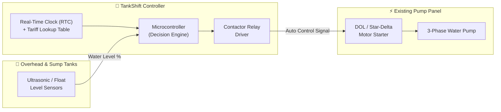
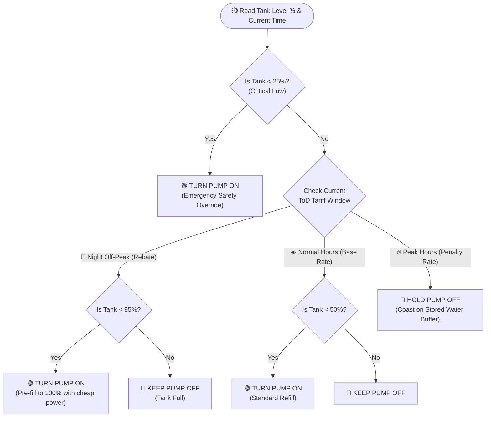

# 💧⚡ TankShift
**Retrofittable, Tariff-Aware Smart Water Pump Controller for Commercial & Institutional Buildings**

TankShift is a low-cost, hardware-agnostic retrofit controller that shifts heavy commercial water pumping away from expensive **Peak Time-of-Day (ToD)** electricity windows into **Off-Peak (Night Rebate)** hours—without ever letting the building run out of water.

---

## 🚨 The Problem: Pumps Are Blind to the Clock
Large commercial buildings, universities, and tech parks operate under **High-Tension (HT) Time-of-Day (ToD)** electricity tariffs. Utilities charge a hefty surcharge during peak daytime/evening hours and offer a rebate at night.

Traditional water level controllers only look at float switches:
* **Tank Low (even at 6:30 PM Peak Hours):** Pump turns ON → Facility pays maximum peak energy rates + spikes its monthly kVA Maximum Demand charge.
* **Night Rebate Window (10:00 PM – 6:00 AM):** Tanks sit partially empty because they haven't hit the bottom float switch yet, missing out on cheap electricity.

---

## 💡 The Solution: TankShift
TankShift sits between existing tank level sensors and the pump motor starter. By combining **real-time water level sensing** with a **programmable ToD tariff table**, TankShift treats overhead water tanks like a **thermal/gravity battery**:
1. **Pre-Fills at Night:** Tops up all overhead tanks to 100% during the cheap night rebate window before college/office hours begin (e.g., before 8:00 AM).
2. **Coasts Through Peak Hours:** Suppresses non-urgent pumping during expensive peak tariff windows as long as water remains above a safe emergency reserve level.
3. **Emergency Override:** If water drops below the critical safety threshold (e.g., <25%) during peak hours, it pumps just enough water to survive until the normal/off-peak window opens.

---

## 📊 System Architecture & Logic Diagrams

### 1. Hardware Retrofit Architecture
*(GitHub renders this diagram automatically)*



### 2. Tariff-Aware Decision Flowchart



### 3. Daily Campus Pumping Schedule (24-Hour Cycle)

```mermaid
gantt
    title TankShift 24-Hour Operation vs. Tariff Windows (Campus Example)
    dateFormat HH:mm
    axisFormat %H:%M

    section Electricity Tariff
    Night Off-Peak Rebate (-₹1/kWh) :done, 00:00, 06:00
    Morning Peak Penalty (+₹1/kWh)  :crit, 06:00, 10:00
    Normal Daytime Tariff           :active, 10:00, 18:00
    Evening Peak Penalty (+₹1/kWh)  :crit, 18:00, 22:00
    Night Off-Peak Rebate (-₹1/kWh) :done, 22:00, 24:00

    section Campus Activity
    Students & Staff Active (8:00 - 17:30) :08:00, 17:30

    section TankShift Pump Action
    Pre-Fill Tanks to 100% (Cheap Power) :02:00, 05:45
    Pumps LOCKED OFF (Morning Peak)      :06:00, 10:00
    Mid-Day Partial Top-Up (If Needed)   :13:00, 15:00
    Pumps LOCKED OFF (Evening Peak)      :18:00, 22:00
    Night Refill Cycle Starts            :22:15, 24:00
```

---

## ✨ Key Innovation vs. Existing Solutions

| Feature | Standard Float Switch | Enterprise BMS (Building Management System) | **TankShift** |
| :--- | :--- | :--- | :--- |
| **Time-of-Day Tariff Aware** | ❌ No | ✅ Yes | ✅ **Yes** |
| **Peak Demand (kVA) Shaving** | ❌ No | ✅ Yes | ✅ **Yes** |
| **Retrofit to Existing Panels** | ✅ Easy | ❌ Requires full panel overhaul | ✅ **Plug-and-Play Retrofit** |
| **Multi-State Tariff Support** | ❌ N/A | ⚠️ Custom vendor programming | ✅ **Configurable JSON/Table Firmware** |
| **Cost** | Low | Very High (₹5L – ₹25L+) | **Ultra-Low (Fast ROI < 6 Months)** |

---

## 📈 Pilot Case Study (15,000-Person University Campus)
* **Target Profile:** Institutional Campus (HT-2(c) Tariff Category) with 3 main pump sets.
* **Base Energy Rate:** ~₹7.00 / kWh (plus ToD Peak Penalty & Night Rebate adders).
* **Estimated Impact:** By shifting daily pumping loads out of peak windows and preventing simultaneous pump starts during daytime campus peak load, a mid-sized campus saves **~₹3.2 Lakhs annually** across energy charges and kVA demand reduction.

---

## 🛠️ Firmware Tariff Configuration Example
TankShift uses a hardware-agnostic, table-driven configuration so it can be deployed across any state electricity board (BESCOM/KERC, MSEDCL, TANGEDCO, etc.) without rewriting core logic:

```json
{
  "region": "KERC_HT_2C",
  "base_rate_inr": 7.00,
  "tank_thresholds": {
    "critical_min_pct": 25,
    "normal_refill_pct": 50,
    "off_peak_target_pct": 98
  },
  "tod_windows": [
    { "start": "06:00", "end": "10:00", "mode": "PEAK",     "adder_inr": 1.00 },
    { "start": "10:00", "end": "18:00", "mode": "NORMAL",   "adder_inr": 0.00 },
    { "start": "18:00", "end": "22:00", "mode": "PEAK",     "adder_inr": 1.00 },
    { "start": "22:00", "end": "06:00", "mode": "OFF_PEAK", "adder_inr": -1.00 }
  ]
}
```

---

## 🚀 Getting Started / Repository Structure
* `/firmware` – Core microcontroller logic (RTC sync, ultrasonic filtering, relay state machine).
* `/config` – State-wise ToD tariff JSON tables.
* `/docs` – Bill savings calculator and wiring schematics for DOL/Star-Delta starters.